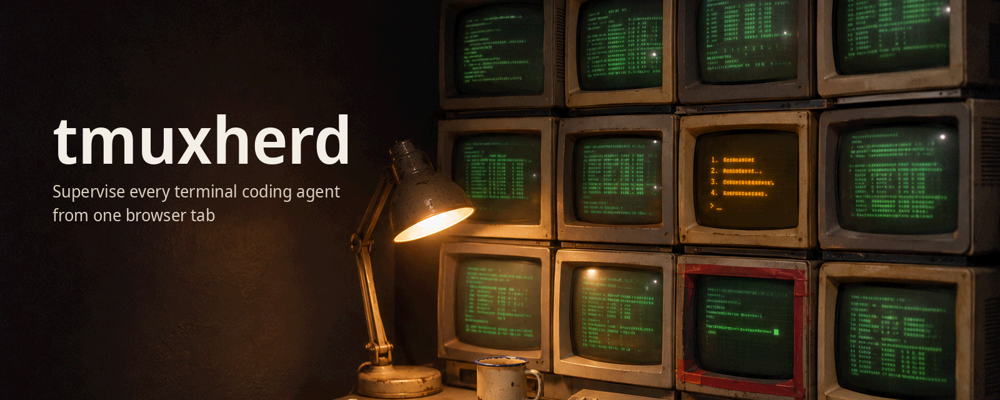
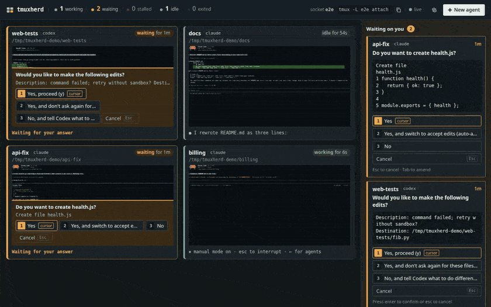

<p align="center">
  
</p>

<p align="center">
  <b>Supervise every terminal coding agent from one browser tab.</b><br>
  Claude Code, Codex CLI, Pi or any CLI agent, running in tmux, on Linux and macOS.<br>
  See them all live, answer their permission prompts, and get told when one stalls.
</p>

<p align="center">
  <a href="https://github.com/vulbsti/tmuxherd/actions/workflows/ci.yml"></a>
  
  
  
</p>

---

If you run several agents at once, you know the failure modes:
- an agent sits for an hour on a harmless "Do you want to proceed?";
- a long run dies on an auth error at 2 a.m. and nobody notices until morning;
- with eight tmux panes there is no single place that tells you who needs you.

**tmuxherd** is one small local web app for those three problems:

- **A live grid of every agent.** Hover a tile to read it; click to zoom in and type.
- **A state for each agent:** working, waiting for you, idle, stalled, or exited. Detected from the screen itself, so it works with any harness.
- **A prompt inbox.** Each waiting agent shows the exact command or file it is asking about, with one button per option. tmuxherd moves the cursor, verifies the selection, and only then presses Enter.
- **A stall watchdog.** Browser, desktop and webhook alerts when an agent has had work pending without progress for N minutes, or exited mid-task.
- **Spawn agents from the UI**, optionally in a fresh git worktree.

It runs its **own** tmux server (`tmux -L tmuxherd`) with its own config, binds to `127.0.0.1` with a per-launch token, and has **zero runtime dependencies**.

<p align="center">
  
  <br><sub>Recorded with real agents in sandbox directories (<code>assets/src/record-demo.mjs</code>):
  <ul>
    <li>Codex asks to retry outside its sandbox;</li>
    <li>a Claude Code edit is approved from the inbox and the file appears;</li>
    <li>a Claude Code pointed at an unreachable API is flagged <b>stalled</b>.</li>
  </ul>
  The stall threshold is 30 s for the recording (default 5 min), and the wait before it trips is sped up 6×.</sub>
</p>

## Quickstart

You need tmux ≥ 3.2, Node ≥ 20 and git, on Linux or macOS.

```bash
sudo apt update && sudo apt install -y tmux git   # Debian/Ubuntu (as root: drop sudo) (Fedora: sudo dnf install tmux git; macOS: brew install tmux)
npm install -g github:vulbsti/tmuxherd   # once it is on npm: npx tmuxherd
tmuxherd --open                  # or open the printed http://127.0.0.1:7420/?token=… URL yourself
```

Then:
1. Click **New agent**, pick an agent (**Claude Code**, **Codex CLI**, **Pi**, **Shell** or **Custom command…**), choose a directory (and optionally a new worktree branch), and start it.
2. When an agent asks for permission, it appears in the inbox with the exact command. Click an option.
3. Close the dashboard whenever you like: the agents keep running. `tmuxherd attach` puts you in the same tmux server from your terminal, and `tmuxherd ls` prints every agent's state.

More: [docs/usage.md](docs/usage.md) covers presets, the config file, notifications, adopting existing panes, and remote access.

## How it works

<picture>
  <source media="(prefers-color-scheme: dark)" srcset="assets/architecture-dark.svg">
  
</picture>

Once a second, tmuxherd asks tmux for each pane's rendered screen (`capture-pane -e -p`). tmux is already the terminal emulator, so nothing is re-implemented in the browser. A pure `detect()` function reads the screen:
- spinners and "esc to interrupt" mean **working**;
- a cursor menu (`❯ 1. Yes`, `› 1. Yes, proceed`) next to a question or footer means **waiting**;
- an input box with no spinner means **idle**.

A tracker then adds time. It strips timers, spinner glyphs and spinner words from the screen. If nothing *else* changes for N minutes while work is pending, or a retry loop or API error appears right after work, the agent is **stalled**.

<picture>
  <source media="(prefers-color-scheme: dark)" srcset="assets/states-dark.svg">
  
</picture>

Details: [docs/architecture.md](docs/architecture.md) · the design decisions and their reasons: [DECISIONS.md](DECISIONS.md) · the HTTP API (scriptable with a bearer token): [docs/api.md](docs/api.md).

## What's tested

Every claim above has a test or a measurement in this repo.

| Claim | Evidence |
|---|---|
| Detects working / waiting / idle / retrying / error for **Claude Code 2.1** and **Codex CLI 0.166** | `test/detect.test.js`: 15 screens recorded from real sandbox runs (`.txt` and `.ansi`), plus negative cases (a numbered list in agent output is not a prompt; an old error is ignored) |
| Stalled = no progress or a retry loop for N min, or an error after work; exited with work pending | `test/tracker.test.js`, with a fake clock, including the recorded Claude retry loop |
| Answers prompts by move → verify → Enter, and refuses stale prompts | `test/tmux.integration.test.js`, against real tmux |
| Approves a **real** Claude Code and a **real** Codex prompt by clicking in the browser | `e2e/real.spec.js` (run locally; it needs logged-in agents). Transcript: [docs/verification/real-e2e.md](docs/verification/real-e2e.md) |
| Spawn from the UI, worktree spawn, stall alert toast, typing in zoom view | `e2e/fake.spec.js` (CI on Linux and macOS) |
| Never loads your `~/.tmux.conf`; never sees or kills panes on other tmux servers | `test/tmux.integration.test.js` (with a control run that proves the test can fail) |
| Token→cookie, DNS-rebinding and cross-origin protections | `test/server.test.js` |

**Overhead**, measured with `node bench/poll-cost.js <panes> 30` (Ryzen AI 7 PRO 350, Linux, Node 26; half the panes have a live spinner):

| panes | tmuxherd CPU | tmux server CPU | tick p50 / p95 | RSS |
|---|---|---|---|---|
| 10 | 1.9 % of one core | 1.2 % | 23 ms / 87 ms | 73 MB |
| 30 | 3.4 % | 2.8 % | 45 ms / 150 ms | 82 MB |

**Limits, honestly:**
- Detection reads the screen, so a TUI redesign in a harness can break it until the patterns are updated. The fixture corpus is small: 15 screens from two harness versions.
- Pi is recognized (preset and idle screen), but its working and prompt screens are not yet in the fixture set.
- The grid refreshes at 1 Hz (4 Hz for the zoomed pane). It is a supervisor, not a replacement for your terminal.
- Windows is not supported (WSL2 is untested).

## Alternatives

This space is busy. Checked on 2026-11-05 against each project's README, docs or site (full notes with sources: [docs/verification/alternatives-research.md](docs/verification/alternatives-research.md)):

| Project | What it is | How tmuxherd differs |
|---|---|---|
| [agent-deck](https://github.com/asheshgoplani/agent-deck) | Go TUI over tmux, plus a 127.0.0.1 web UI with a token, push notifications, Telegram/Slack bridges, worktrees, many harnesses. Hook-assisted status detection | **The closest tool, and more mature.** tmuxherd is smaller (no binary, zero deps) and grid-first; agent-deck has far more features |
| [Conductor](https://www.conductor.build) | macOS app for parallel Claude Code / Codex in worktrees, with diff review and PRs. Closed source. Meta's acquisition was reported on 2026-11-04; its cloud shuts down 2026-11-20 | Conductor is macOS-only and review-centric. tmuxherd is Linux and macOS, open source, and terminal-native, with no review or merge features |
| [Claude Squad](https://github.com/smtg-ai/claude-squad) | Go TUI: agents in tmux + worktrees, with diff preview | No browser UI or remote prompt answering (only `--autoyes`), and no notifications |
| [Vibe Kanban](https://github.com/BloopAI/vibe-kanban) | Local web kanban + workspaces for 10+ agents, with approvals in the UI and desktop notifications | Task-board workflow with its own executors; the company sunset it in April 2026 and it is now community-maintained. tmuxherd supervises the agents you already run in terminals |
| [ccmanager](https://github.com/kbwo/ccmanager) | Node TUI with its own PTYs (no tmux), per-harness busy/waiting/idle, worktrees | No web or remote UI and no stall detection; notifications are DIY hooks |
| [cmux](https://github.com/manaflow-ai/cmux) | Native macOS terminal (Ghostty-based) with attention rings and notifications | A terminal app for macOS, not a supervisor; no stall detection |
| [Happy](https://github.com/slopus/happy) | E2E-encrypted mobile/web client wrapping Claude Code / Codex, with push and approvals on your phone | Needs its relay server and wraps each agent; tmuxherd is local-only and wraps nothing |
| [CloudCLI / claudecodeui](https://github.com/siteboon/claudecodeui) | Self-hosted web UI for Claude Code / Cursor CLI / Codex sessions, with a permission banner | Chat-centric, one session at a time; not a live grid of terminals |
| [Nimbalyst](https://github.com/Nimbalyst/nimbalyst) (formerly Crystal) | Electron workspace for parallel Claude Code / Codex, with an iOS companion | A desktop app with editors and review; heavier, not tmux-based |
| [Claude Control](https://github.com/sverrirsig/claude-control) | macOS Electron dashboard for Claude Code: approve from the dashboard, notifications | macOS and Claude only |
| [Sculptor](https://github.com/imbue-ai/sculptor) | Desktop app for parallel agents in worktrees | Integrated agents run with tool permissions auto-approved; a different philosophy |

Others checked: [opcode](https://github.com/winfunc/opcode) (Claude GUI, dormant since 2025-10), [uzi](https://github.com/devflowinc/uzi) and [Tmux-Orchestrator](https://github.com/Jedward23/Tmux-Orchestrator) (both dormant), [Omnara](https://github.com/omnara-ai/omnara) (pivoted to a managed-agent platform), and [agent-dashboard](https://github.com/bjornjee/agent-dashboard) (a small TUI + PWA, close in spirit).

**Where others are ahead:** hook-based detection (agent-deck, Claude Control) is more exact than screen-reading for harnesses that have hooks. Review-and-merge workflows belong to Conductor, Nimbalyst and Vibe Kanban, and native phone apps to Happy and Nimbalyst. tmuxherd's bet is a small, auditable, harness-agnostic supervisor for the terminals you already use.

## Security

tmuxherd can type into your terminals, so it is built defensively:
- It listens on 127.0.0.1 only.
- It uses a random per-launch token, swapped for an HttpOnly, SameSite=Strict cookie.
- Host and Origin checks block DNS rebinding and cross-site requests.
- A strict CSP is set.
- It runs its own tmux server with its own config.
- It only touches panes on other tmux servers if you `--adopt` them, and never kills them.

For remote access, use an SSH tunnel. See [SECURITY.md](SECURITY.md).

## Contributing

Start with [CONTRIBUTING.md](CONTRIBUTING.md) and [AGENTS.md](AGENTS.md). The latter is also the guide for AI coding agents working on this repo. Good first issues are listed in [docs/ROADMAP.md](docs/ROADMAP.md). The most valuable contribution is a recorded screen from a harness version that tmuxherd gets wrong.

## License

[Apache-2.0](LICENSE)
