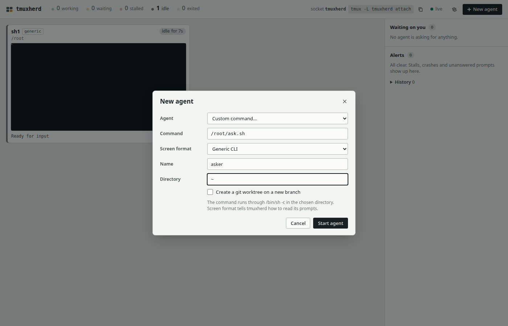
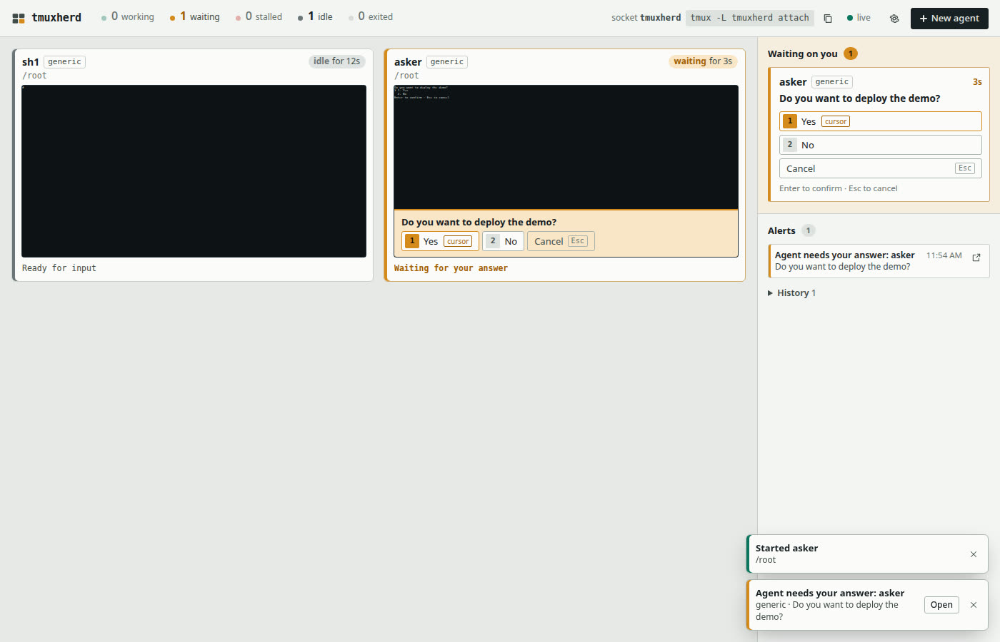
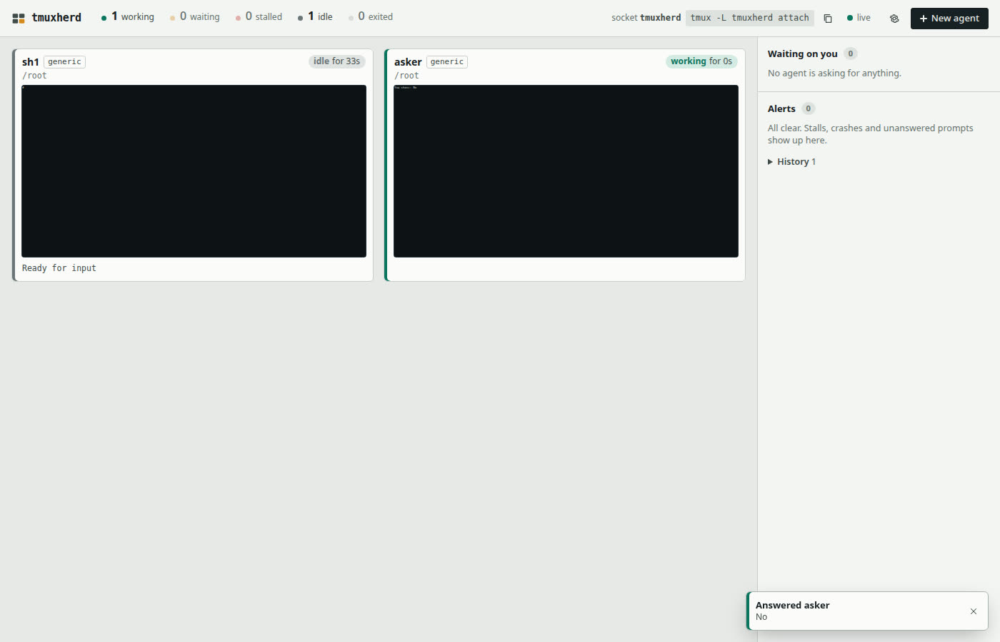
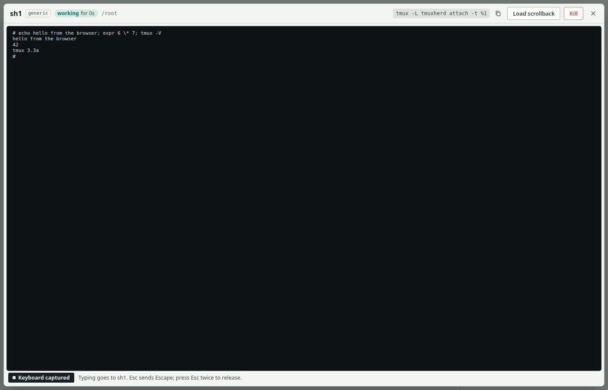

**Verdict: PASS.** All six Quickstart steps worked through the browser UI in a clean Debian 12 container, using only the README and the docs it links to. I found three minor doc and UI wording problems (F1–F3 below). None of them blocked a step.

# Fresh-user run 4 (superseded by run 6 in `fresh-user.md`)

This is run 4, on `1b0004f`, before the audit-round-3 fixes. Earlier runs: run 1 is in `fresh-user-run1.md`, and runs 2 and 3 are summarized in `VERIFICATION.md`.

- **Date:** 2026-11-06
- **tmuxherd:** 0.1.0, commit `1b0004f`, installed with `npm install -g` from the git source. Its `src/` and `public/` match the later commit `f7355d0`; that commit only touches a doc and a test.
- **Container:** `node:22-bookworm-slim`: Debian 12.15, Node v22.23.4, npm 10.9.9, running as root. Docker 29.9.2, host networking.
- **Installed in the container:** tmux 3.3a and git 2.39.5 from Debian apt. tmux was not upgraded.
- **Browser:** Playwright 1.64.1 Chromium on the host (Node 26.9), viewport 1400×900. I found controls by their visible labels and roles. I did not read tmuxherd's source.
- **Only allowed substitution:** `github:vulbsti/tmuxherd` was replaced with `git+file:///src/tmuxherd.git`, a read-only bind mount of the same repository.

## Install

The README Quickstart line, with `sudo` dropped as its comment says to do as root:

```
$ apt update && apt install -y tmux git
...
$ tmux -V; git --version
tmux 3.3a
git version 2.39.5
```

```
$ npm install -g git+file:///src/tmuxherd.git
npm error command git --no-replace-objects ls-remote file:///src/tmuxherd.git
npm error fatal: detected dubious ownership in repository at '/src/tmuxherd.git'
```

**F0 (test harness, not a doc problem).** The bind-mounted repository belongs to the host user, not root, so git refuses it. A real user installing from GitHub does not hit this. I ran `git config --global --add safe.directory /src/tmuxherd.git` and retried:

```
$ npm install -g git+file:///src/tmuxherd.git
added 1 package in 665ms
$ tmuxherd --version
0.1.0
```

`tmuxherd --help` lists `serve`, `ls [--json]`, `attach [name]` and the options from usage.md.

## Start the dashboard

```
$ cd /root && nohup tmuxherd --port 7432 > /tmp/th.log 2>&1 &
$ cat /tmp/th.log
tmuxherd 0.1.0 ready
  dashboard: http://127.0.0.1:7432/?token=nzI7…
  tmux:      tmux -L tmuxherd attach    (agents keep running if you stop the dashboard)
```

## Step 1: open the URL

I opened the printed URL in Chromium. It redirected to `http://127.0.0.1:7432/` (the token was swapped for a cookie, as api.md says), with the page title "tmuxherd". The page showed:
- a header with state counters (`0 working`, `0 waiting`, `0 stalled`, `0 idle`, `0 exited`), the `tmux -L tmuxherd attach` command, a green "live" indicator, a settings gear and **New agent**;
- an empty state: "No agents yet", with a second **New agent** button;
- a right-hand rail: "Waiting on you 0" and "Alerts 0".

## Step 2: spawn a `shell` and a `custom` agent

**Shell.** I clicked **New agent**. The dialog's fields match the usage.md table: **Agent** (Claude Code, Codex CLI, Pi, Shell, Custom command…), **Name**, **Directory**, **First message**, **Extra arguments**, and **Create a git worktree on a new branch**. I chose **Shell**, set Name `sh1` and Directory `~`, and clicked **Start agent**. First message grayed out, with the note "Shell does not take a first message." A toast said "Started sh1 /root", and a tile `sh1 · generic · /root` appeared, first as "working", then "idle" with "Ready for input".

The tile looked empty, so I checked tmux. The pane runs `/bin/sh` with the prompt `#`. `docker exec` does not export `$SHELL`, and usage.md documents this fallback ("your `$SHELL`, else `/bin/sh`"), so the behavior is correct. The tile is just showing a one-character prompt.

**Custom.** From usage.md's "What counts as a prompt" section, I wrote a tiny menu. It has a question ending in `?`, numbered options with a `❯` cursor, and the `Enter to confirm · Esc to cancel` footer. It reacts to the Up and Down arrows and to Enter. Saved as `/root/ask.sh` in the container:

```bash
#!/bin/bash
opts=("Yes" "No"); sel=0
draw() { clear; echo "Do you want to deploy the demo?"
  for i in "${!opts[@]}"; do
    if [ "$i" -eq "$sel" ]; then echo "❯ $((i+1)). ${opts[$i]}"; else echo "  $((i+1)). ${opts[$i]}"; fi
  done; echo "Enter to confirm · Esc to cancel"; }
draw
while IFS= read -rsn1 k; do
  if [ "$k" = $'\e' ]; then read -rsn2 -t 0.1 rest
    case "$rest" in "[A") [ $sel -gt 0 ] && sel=$((sel-1));; "[B") [ $sel -lt 1 ] && sel=$((sel+1));; esac; draw
  elif [ -z "$k" ]; then break; fi
done
clear; echo "You chose: ${opts[$sel]}"
echo "$(date -u +%FT%TZ) chose ${opts[$sel]}" > /root/answer.txt
exec sleep 100000
```

Then: **New agent** → Agent **Custom command…**. Two new fields appeared, **Command** and **Screen format** (default "Generic CLI"), with the note "The command runs through /bin/sh -c in the chosen directory." I set Command `/root/ask.sh`, Screen format **Generic CLI**, Name `asker` and Directory `~`, then clicked **Start agent**.



Within about 3 s:
- The `asker` tile turned amber with "waiting for 3s", with the question and option buttons shown under its screen.
- **Waiting on you 1** showed the card: "asker · generic", "Do you want to deploy the demo?", then buttons **1 Yes** (tagged `cursor`), **2 No** and **Cancel** (tagged `Esc`), and the footer line.
- The **Alerts** list and a toast both said "Agent needs your answer: asker".



## Step 3: answer from the inbox

I clicked **2 No** in the inbox card. I picked No so that tmuxherd had to move the cursor. Results:
- A toast said "Answered asker · No".
- "Waiting on you" and "Alerts" returned to 0, and "History" went to 1.
- The tile switched to "working" for a few seconds, then to idle. That matches usage.md for generic agents, whose working/idle state depends on recent screen change.

The agent got the answer:

```
$ tmux -L tmuxherd capture-pane -p -t %2
You chose: No
$ cat /root/answer.txt
2026-11-06T06:24:41Z chose No
```

The server log says `answered asker: No`.



## Step 4: zoom into the shell tile and type

I clicked the `sh1` tile. A full-window view opened with a header (`sh1 · generic · idle for 56s · /root`, `tmux -L tmuxherd attach -t %1`, **Load scrollback**, **Kill**, **Close**). Its footer read "Keyboard captured. Typing goes to sh1. Esc sends Escape; press Esc twice to release." I typed `echo hello from the browser; expr 6 \* 7; tmux -V` and pressed Enter. The output appeared in the zoom view within about 1.5 s:

```
# echo hello from the browser; expr 6 \* 7; tmux -V
hello from the browser
42
tmux 3.3a
#
```

`tmux capture-pane` showed the same output.



Pressing Esc twice **closed** the zoom view; it did not just release the keyboard (see F3). I tried this twice. I also clicked **Close** once.

## Step 5: `tmuxherd ls` and `tmuxherd attach`

```
$ date -u +%T; tmuxherd ls
06:26:10
o1     sh1                generic idle         2m  /root
o2     asker              generic idle         1m  /root
```

The time column makes sense. usage.md calls it uptime, and `ls --json` gives `sh1`'s `created` as 06:24:01, which is 2 min 9 s before 06:26:10. The output has no header row, so the column needs usage.md to explain it.

`ls --json` printed the pane objects (`key`, `paneId`, `name`, `harness`, `state`, `since`, `created`, `command: "/bin/sh"`, `attach`, …). Its `since` field is wrong; see F1.

```
$ docker exec -t th-fresh4 bash -lc 'timeout 3 script -qc "tmuxherd attach" /dev/null'
root@…:~#
[tmuxherd] 0:home* 1:sh1  2:asker                       "…" 06:26 06-Nov-26
```

It attached to tmuxherd's own server. The status bar lists `home`, `sh1` and `asker`, and the attach landed on the `home` placeholder. The `timeout` then ended the session, which printed `Session terminated, killing shell... ...killed.`; that message comes from `script`, not tmuxherd. Both agents were still listed afterwards.

`--help` shows `attach [name]`, so I tried `tmuxherd attach sh1`. It printed `Can't find session: sh1`. `tmuxherd attach herd` (the session name from `--help`) worked. See F2.

## Step 6: stop the dashboard; agents keep running

usage.md says "Stop the dashboard with Ctrl-C". The server ran under `nohup`, so I sent the same signal with `kill -INT` while the browser was open. The slim image has no `ps` or `pgrep`, so I found the PID through `/proc/*/cmdline`. The process exited, and the log added nothing after `answered asker: No`. Within about 4 s the browser header changed from "live" to a red "disconnected, retrying". The tiles stayed visible.

```
$ date -u +%T; tmuxherd ls
06:27:41
o1     sh1                generic idle         3m  /root
o2     asker              generic idle         3m  /root
$ tmux -L tmuxherd list-panes -a -F "#{window_name} pid=#{pane_pid} dead=#{pane_dead}"
home pid=3669 dead=0
sh1 pid=3674 dead=0
asker pid=3713 dead=0
$ tmux -L tmuxherd capture-pane -p -t %2
You chose: No
```

Both agents kept running with the dashboard stopped.

## Friction points

| # | Kind | What happened |
|---|---|---|
| F0 | Test harness | `git` refused the bind-mounted repository because of "dubious ownership". This comes from the allowed substitution, not from the docs. Fixed with `safe.directory`. |
| F1 | Doc / behavior mismatch | usage.md says `tmuxherd ls --json` prints "the same, as the API's pane objects", and api.md defines `since` as "when this state began". But `ls --json` sets `since` (and `lastProgress`) to the moment `ls` ran. At 06:26:42, `/api/state` gave `since` 06:25:23 for `sh1` and 06:24:45 for `asker`, while `ls --json` gave 06:26:42 for both. Scripts that read `since` from `ls --json` get a wrong value. Either document that `ls` has no state history, or omit or fix those fields. |
| F2 | Doc gap | `tmuxherd attach [name]` takes a tmux **session** name, not an agent name. `tmuxherd attach sh1` → `Can't find session: sh1`. usage.md does not document `[name]`, and `--help` doesn't say what it is. Also, plain `attach` lands on `home` even when agents exist; usage.md only mentions `home` for the case with no agents. |
| F3 | UI wording | The zoom footer says "press Esc twice to release", but pressing Esc twice closes the zoom view. usage.md does not describe the zoom view's keys. |
| F4 | Environment, matches docs | The `shell` preset ran `/bin/sh`, because `docker exec` does not export `$SHELL`. This is the documented fallback. |

Other notes:
- The durations on the tiles ("idle for 51s") refresh about every 5 s, not every second. That's fine for a supervisor.
- The dialog's option labels ("Shell", "Custom command…", "Generic CLI") differ slightly from usage.md's `shell`, `custom` and `generic`, but they are easy to map.
