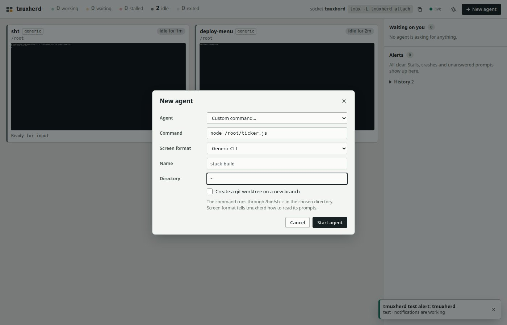
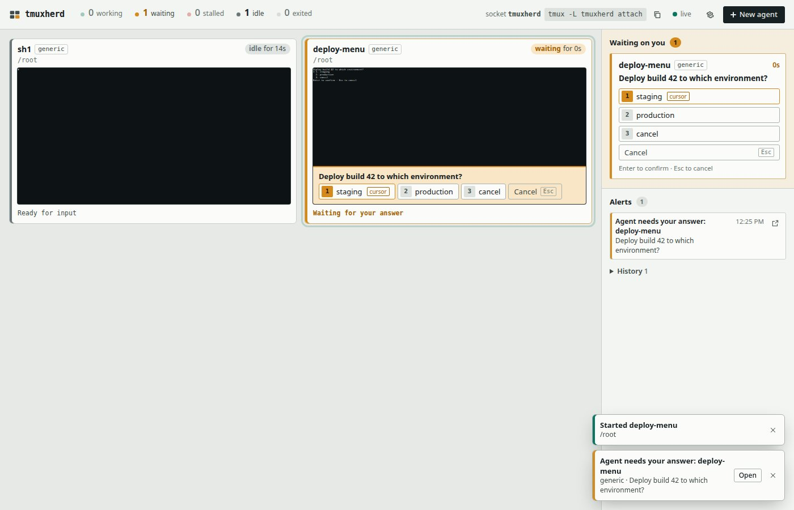
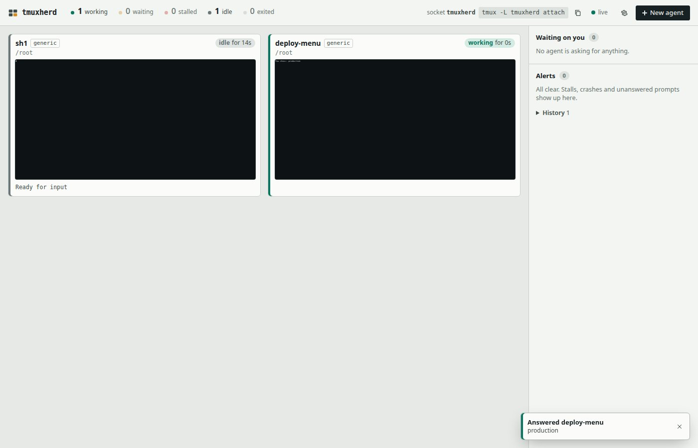
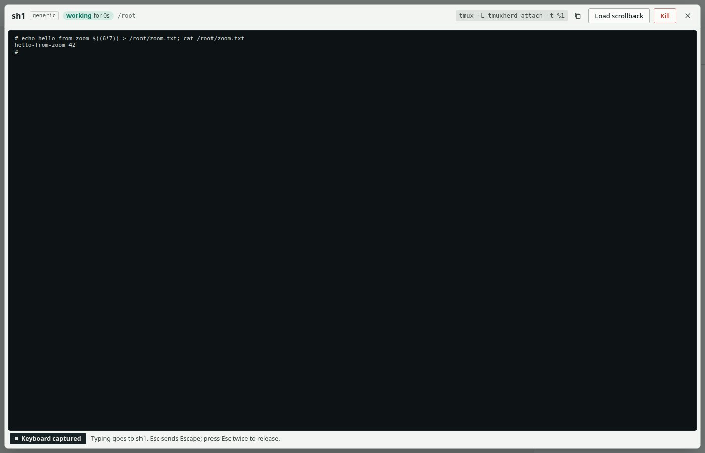
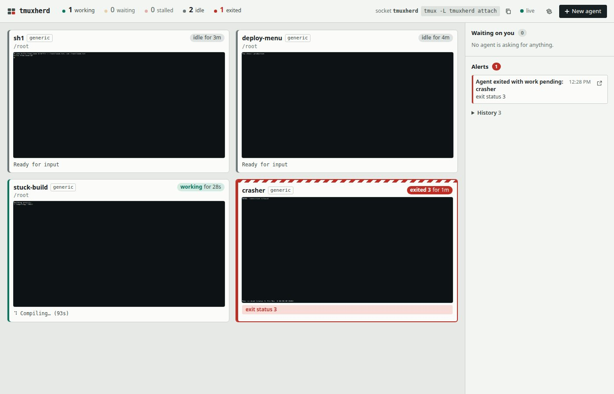

**Verdict: PASS.** Every Quickstart step and every README/usage.md promise I could test without real AI agents worked as documented; I found only small, cosmetic doc and CLI-help mismatches.

# Fresh-user run 5 (superseded by run 6 in `fresh-user.md`)

## Environment

- Date: 2026-11-06 (06:53–07:02 UTC)
- tmuxherd commit: `c09321e` (bare mirror, installed as `tmuxherd 0.1.0`)
- Container image: `node:22-bookworm-slim` (image id `5ec23b7c622b`), `--network host`, running as root
- Debian 12.15, Node v22.23.4 (npm 10.9.9), tmux 3.3a, git 2.39.5 (the last two installed by the README's apt line)
- Browser: Playwright Chromium (`chromium-1248`) on the host, 1400×900 viewport. Default headless for steps a–d, and the new headless mode (`channel: 'chromium'`) for steps f–g. Controls were found by role and visible label.
- Docs I read: `README.md`, `docs/usage.md` and `docs/api.md`, read from the mirror with `git show HEAD:…`. I did not read any source code.
- Browser scripts (in this directory): `run1.mjs` (shell spawn), `run2.mjs` (custom spawn and inbox answer), `run3.mjs` (zoom), `run5.mjs`–`run7.mjs` (settings, alerts, worktree, kill), `run8.mjs` (restart) and `run9.mjs` (config file, preset, webhook).

## Step 0: Install (README Quickstart, lines 1–2)

```console
# apt update && apt install -y tmux git          # README line, sudo dropped (root)
...
Setting up git (1:2.39.5-0+deb12u3) ...
# tmux -V; git --version
tmux 3.3a
git version 2.39.5
# npm install -g git+file:///src/tmuxherd.git    # allowed substitution for github:vulbsti/tmuxherd
npm error command git --no-replace-objects ls-remote file:///src/tmuxherd.git
npm error fatal: detected dubious ownership in repository at '/src/tmuxherd.git'
npm error 	git config --global --add safe.directory /src/tmuxherd.git
# git config --global --add safe.directory /src/tmuxherd.git     # harness fix (allowed)
# npm install -g git+file:///src/tmuxherd.git
added 1 package in 666ms
# tmuxherd --version
0.1.0
```

Harness notes:
- The host's Docker is the snap package, which has a private `/tmp`. The `-v <mirror>:/src/tmuxherd.git:ro` bind mount was therefore **empty** inside the container. The first `npm install` failed with `'/src/tmuxherd.git' does not appear to be a git repository`.
- I recreated `th-fresh5` without the mount and ran `docker cp`, which put the mirror at the same `/src/tmuxherd.git` path. Then `chmod -R a-w`.
- That copy is owned by uid 1000, which caused the "dubious ownership" error. `safe.directory` fixed it.
- Neither problem comes from tmuxherd.

## Step a: Start and open the printed URL

I ran the README line literally first:

```console
# timeout 5 tmuxherd --open
tmuxherd 0.1.0 ready
  dashboard: http://127.0.0.1:7420/?token=-0GJ…
  tmux:      tmux -L tmuxherd attach    (agents keep running if you stop the dashboard)
tmuxherd: could not open a browser (xdg-open); open the dashboard URL above yourself
```

The container has no browser, so the fallback message is correct and helpful. The default port 7420 matches the README. I then ran it on the requested port:

```console
# tmuxherd --port 7432 > /root/th.log 2>&1 &
tmuxherd 0.1.0 ready
  dashboard: http://127.0.0.1:7432/?token=00Wv…
  tmux:      tmux -L tmuxherd attach    (agents keep running if you stop the dashboard)
```

Results in the browser (`run1.mjs`):
- Opening the printed URL redirected to `http://127.0.0.1:7432/`, as api.md describes.
- It set the cookie `tmuxherd_7432 httpOnly=true sameSite=Strict`.
- The empty state shows the heading "No agents yet" and a "New agent" button.

On the host, from curl:

```console
$ ss -ltn | grep 7432
LISTEN 0 511 127.0.0.1:7432 0.0.0.0:*
$ curl … /api/state                       -> no auth: 401
$ curl -H 'Host: evil.example' …/         -> 421
```

## Step b: Spawn a Shell agent and a Custom-command agent

The test program is `/root/menu.js`, a tiny Node raw-mode menu that follows usage.md's "what counts as a prompt" rules:
- a question line ending in `?`;
- numbered options with exactly one `❯` cursor;
- an `Enter to confirm · Esc to cancel` footer.

Up and Down move the cursor. Enter writes the choice to `/root/menu-answer.txt` and prints `You chose: <x>`.

Steps in the browser:
- **New agent** → Agent **Shell**, Name `sh1`, Directory `~` → **Start agent**. The tile appeared: `sh1 generic working for 0s /root #`, then `idle`.
- **New agent** → Agent **Custom command…**. This reveals the **Command** and **Screen format** fields, plus the help line "The command runs through /bin/sh -c in the chosen directory." I filled Command `node /root/menu.js`, Screen format **Generic CLI**, Name `deploy-menu`, Directory `/root` → **Start agent**.
- 1289 ms later the inbox header read "Waiting on you 1". The banner read `0 working · 1 waiting · 0 stalled · 1 idle · 0 exited`.

The spawn dialog, as captured for a later Custom-command agent (`stuck-build`, step g). The dialog is the same one used for `deploy-menu`:



## Step c: Answer the prompt from "Waiting on you" with a non-default option

This is the inbox card's accessibility tree, verbatim:

```
region "Waiting on you 1":
  heading "Waiting on you 1"
  article:
    button "deploy-menu generic"
    paragraph: Deploy build 42 to which environment?
    button "1 staging cursor"
    button "2 production"
    button "3 cancel"
    button "Cancel Esc"
    paragraph: Enter to confirm · Esc to cancel
```



I clicked **2 production**, which is not the default (the cursor was on 1).

```console
answer file before: cat: /root/menu-answer.txt: No such file or directory
clicked production
inbox empty again                      ("Waiting on you 0")
# cat /root/menu-answer.txt
production
# tmux -L tmuxherd capture-pane -p -t herd:deploy-menu
You chose: production
toast: "Answered deploy-menu / production"
```

The program received the non-default answer. The tile went to `working`, then (as usage.md says for generic tools) `idle` a few seconds later.



## Step d: Zoom into the shell tile, type, then Esc Esc

Script: `run3.mjs`.
- Clicking the `sh1` tile opened the dialog "sh1". Its header has a `tmux -L tmuxherd attach -t %1` code chip, **Copy attach command**, **Load scrollback**, **Kill** and **Close**.
- Focus was on the terminal div, labelled "Terminal. Click to type into the agent; press Escape twice to stop."
- The footer read: **Keyboard captured**: "Typing goes to sh1. Esc sends Escape; press Esc twice to release."

I typed the following, then pressed Enter:

```
echo hello-from-zoom $((6*7)) > /root/zoom.txt; cat /root/zoom.txt
```

```console
# cat /root/zoom.txt
hello-from-zoom 42
# tmux -L tmuxherd capture-pane -p -t herd:sh1
# echo hello-from-zoom $((6*7)) > /root/zoom.txt; cat /root/zoom.txt
hello-from-zoom 42
#
```



After Esc, then 120 ms later Esc again:
- The footer changed to **Keyboard released**: "Click the screen to type into the agent. Esc closes this view." Focus moved to the Close button.
- I typed `zzzleak`. Did it reach the pane? `false`.
- A third Esc closed the zoom view. Does the dialog stay open? `false`.

This matches usage.md exactly. A screenshot of the released state is in `zoom-released.png`.

Note: my first attempt at this script died before typing anything, because my own `| head -150` closed its stdout pipe. That was a harness error. The rerun above is the one recorded.

## Step e: `tmuxherd ls`, `ls --json`, `attach`

```console
# tmuxherd ls
o1     sh1                generic idle         1m  /root
o2     deploy-menu        generic idle         1m  /root
# tmuxherd ls --json
[
  {
    "key": "o1", "paneId": "%1", "pid": 3710, "own": true, "socket": "tmuxherd",
    "name": "sh1", "session": "herd", "harness": "generic", "state": "idle",
    "since": 1793948210630, "reason": null, "pending": false,
    "lastProgress": 1793948210630, "stuckSince": null, "prompt": null,
    "activity": null, "error": null, "cwd": "/root", "worktree": null,
    "dead": false, "exitStatus": null, "width": 200, "height": 50,
    "created": 1793948123987, "command": "/bin/sh",
    "attach": "tmux -L tmuxherd attach -t %1"
  },
  { "key": "o2", … "name": "deploy-menu", … "command": "/bin/sh -c node /root/menu.js",
    "attach": "tmux -L tmuxherd attach -t %2" }
]
```

(The JSON is condensed; the full output is one field per line.) `since` and `lastProgress` are "now", as usage.md says. The objects match api.md's pane view, plus one undocumented `pid` field.

`attach`, run through `script` to give it a pty. `docker exec` sets no `TERM`, so the first try failed with `open terminal failed: terminal does not support clear`. That is a harness issue, and a real terminal has `TERM`. With `TERM=xterm-256color`, I sent Ctrl-b d after 2 s:

```console
# tmuxherd attach
[tmuxherd]0:home* 1:sh1  2:deploy-menu        "…" 06:57 06-Nov-26
[detached (from session herd)]
EXIT=0
# tmuxherd attach herd
[tmuxherd]0:home* 1:sh1  2:deploy-menu …
[detached (from session herd)]
EXIT=0
# tmuxherd attach sh1
can't find session: sh1
EXIT=1
```

`attach` lands on the `home` window, and Ctrl-b d detaches, as usage.md says. `attach sh1` fails because the argument is a session, which is what usage.md says (`attach [session]`). However, `tmuxherd --help` prints `tmuxherd attach [name]`, which suggests an agent name works. See friction point 2.

## Step f: Stop the dashboard; agents keep running

The slim image has no `pkill`, `pgrep` or `ps`, so I found the PID via `/proc` and sent SIGINT, which is what Ctrl-C sends:

```console
# kill -INT 3607
--- processes still alive:
3704 tmux -L tmuxherd -f /usr/local/lib/node_modules/tmuxherd/src/tmuxherd.conf new-session -d -s herd -n home -x 200 -y 50
3761 node /root/menu.js
4639 node /root/ticker.js
# tmuxherd ls            # dashboard is down
o2     deploy-menu        generic idle         4m  /root
o1     sh1                generic idle         5m  /root
o5     wt-shell           generic idle        40s  /root/repo.worktrees/try-tmuxherd
o3     stuck-build        generic working      2m  /root
$ curl http://127.0.0.1:7432/   -> 000 (curl exit 7, connection refused)
```

The tmux server was started with its own `-f …/tmuxherd.conf`, not `~/.tmux.conf`. I restarted with `tmuxherd --port 7432`, which printed a new token, `Tnd2…`. Every agent was picked up again with its name, harness and worktree (`run8.mjs`):

```
tile: sh1 | generic | idle | for 0s | /root
tile: deploy-menu | generic | idle | for 0s | /root | You chose: production
tile: stuck-build | generic | working | for 5s | /root
tile: wt-shell | generic | try-tmuxherd | idle | for 0s | /root/repo.worktrees/try-tmuxherd
```

The screenshot is `after-restart.png`.

## Step g: Settings, stall threshold, alerts, worktree, Kill, config file, webhook

**Settings panel** (gear button "Watchdog and notification settings"):
- It has spinbuttons **Stalled after** (5), **Exited alert after** (0) and **Waiting alert after** (0), the checkbox "Alert when an agent asks a question", **Enable browser notifications** and **Send test alert**.
- In old-headless Chromium the button read "Browser notifications blocked" (disabled), because `Notification.permission` is `denied` there. In new headless it is `default`, and the button reads "Enable browser notifications". I did not click it, because there is no real notification UI to grant.

**Runtime threshold change:**
- I set Stalled after = 1 and pressed Tab. The status read "Saved. The watchdog uses these values from now on."
- `GET /api/state` with the bearer token returned `thresholds: {"stallMinutes":1,"deadMinutes":0,"waitingMinutes":0,"notifyWaiting":true}`.

**Send test alert:** the toast read "tmuxherd test alert: tmuxherd / test · notifications are working", and the History count went up.

**Stall detection:**
- The test agent was Custom `node /root/ticker.js`, named `stuck-build`, using the Generic format. It prints a cycling spinner glyph and `Compiling… (Ns)` every second, so it never makes real progress.
- Sampled every 5 s, the tile went `working for 4s` … `working for 59s` → **`stalled for 2s`** at +65 s, with the reason "no screen progress".
- The Alerts panel showed "Agent stalled: stuck-build / no screen progress", along with a toast that has an **Open** button.
- This matches the docs' claim that a ticking timer and spinner do not count as progress.

**Exited with work pending:**
- The test agent was Custom `echo "running migrations"; sleep 4; echo "FATAL: connection refused"; exit 3`, named `crasher`.
- Its tile went to **`exited 3`**, with the alert "Agent exited with work pending: crasher / exit status 3". The banner read `1 stalled · 2 idle · 1 exited`.

**Threshold reset:** setting the threshold back to 5 cleared the stall alert. The condition was no longer met, which matches "clears when the condition does".



**Worktree spawn:**
- In `/root/repo` (a fresh git repo on `main`), I chose Shell, Name `wt-shell`, Directory `~/repo`, ticked "Create a git worktree on a new branch", and set **Branch** `try-tmuxherd` (**From** left at "current HEAD").
- The tile showed the branch chip `try-tmuxherd` and cwd `/root/repo.worktrees/try-tmuxherd`.
- `git worktree list` showed `/root/repo.worktrees/try-tmuxherd  cb6b65a [try-tmuxherd]`. This matches `<repo>.worktrees/<branch>`.

**Load scrollback / Kill** (zoom on `crasher`):
- **Load scrollback** showed the full history: `running migrations`, `FATAL: connection refused`, `Pane is dead (status 3, …)`. The button then became **Back to live**. The footer read "Pane has exited. Nothing can be typed into an exited pane."
- **Kill** turned into a second, confirming button, **"Kill crasher?"**. Clicking that removed the tile and the tmux window, and cleared the crasher alert.

**Config file:** I wrote `~/.config/tmuxherd/config.json` with `port 7432`, `stallMinutes 8`, `webhook http://127.0.0.1:9977/hook` (a tiny receiver in the container), `webhookFormat json`, and a preset `"deploy-menu": {"label": "Deploy menu", "argv": ["node","/root/menu.js"], "promptArg": false, "harness": "generic"}`. Then I started plain `tmuxherd` with no flags. Results:
- It came up on 7432, so the port came from the config.
- Settings showed Stalled after = 8 and "A webhook is configured."
- **Send test alert** delivered `POST /hook application/json {"source":"tmuxherd","id":"test:…","kind":"test","name":"tmuxherd","harness":"test","detail":"notifications are working",…,"title":"tmuxherd test alert: tmuxherd","body":"test · notifications are working"}`.
- The Agent dropdown listed `Claude Code, Codex CLI, Pi, Shell, Deploy menu, Custom command…`.
- Spawning **Deploy menu** put the prompt in the inbox. Clicking **3 cancel** made the pane print `You chose: cancel`.
- The waiting alert also reached the webhook: `{"kind":"waiting","name":"menu2","detail":"Deploy build 42 to which environment?",…}`.

**Hover:** when the mouse rests on a tile, an enlarged, readable copy of it appears, which fits "Hover a tile to read it". The preview covers the inbox and alerts sidebar while it is open.

Not tested: real claude, codex and pi agents; `--desktop-notify` (there is no notify-send in the container); actually granting browser notifications; `--adopt`; remote access.

## Friction points

| # | Kind | What happened |
|---|---|---|
| 1 | Doc wording (cosmetic) | README step 1 says "pick `claude`, `codex`, `pi`, `shell` or `custom`". The dialog's Agent dropdown labels are "Claude Code", "Codex CLI", "Pi", "Shell" and "Custom command…". Easy to map, but not the words the README uses. |
| 2 | CLI help vs docs | `tmuxherd --help` shows `tmuxherd attach [name]`; usage.md shows `tmuxherd attach [session]`. Following the help, `tmuxherd attach sh1` (an agent name) fails with `can't find session: sh1`. The docs are right and the help text is misleading. |
| 3 | API doc gap (minor) | `tmuxherd ls --json` pane objects include a `pid` field that api.md's "Pane view object" does not list. |
| 4 | Undocumented UI (minor) | **Kill** needs a second click on a "Kill <name>?" button. usage.md only says "**Kill** stops an agent". The confirmation is sensible but undocumented. |
| 5 | Cosmetic | `tmuxherd ls` row order is unstable. The first run printed o1, o2; after restarts it printed o2, o1, o5, o3. This is not key order, and not the dashboard's tile order (sh1, deploy-menu, stuck-build, wt-shell). |
| 6 | Cosmetic | Tile "for Ns" badges refresh in about 5 s steps. Sampled once a second, the badge read "idle for 52s" five times, then "57s". This is not a doc claim; it just looks frozen at first glance. |
| 7 | UX (minor) | The hover preview of a tile covers the "Waiting on you" and Alerts sidebar while the mouse rests on a tile. |
| 8 | Harness | Snap Docker has a private `/tmp`, so the bind-mounted mirror was empty. I recreated the container and used `docker cp` into the same path. |
| 9 | Harness | `git` refused the copied mirror for "dubious ownership". Fixed with `git config --global --add safe.directory /src/tmuxherd.git`. |
| 10 | Harness | `docker exec` has no `TERM`, so `tmuxherd attach` (tmux) failed with "terminal does not support clear" until I set `TERM=xterm-256color`. |
| 11 | Harness | `node:22-bookworm-slim` has no `ps`, `pgrep` or `pkill`. I stopped the dashboard with `kill -INT <pid>` (equivalent to Ctrl-C) after finding it via `/proc`. |
| 12 | Harness | In old-headless Chromium, notifications show as "blocked". New headless (`channel: 'chromium'`) shows "Enable browser notifications". |

## Follow-up (added by the maintainer)

- 1, 3, 4: fixed in README.md, api.md and usage.md.
- 2: usage.md now says that `--help`'s `[name]` is a tmux session name. Changing the help text itself is listed for 0.1.1 in `docs/ROADMAP.md`, together with 5, 6 and 7.
- 8–12: test-harness issues, not tmuxherd behavior. (A real terminal sets `TERM`.)
