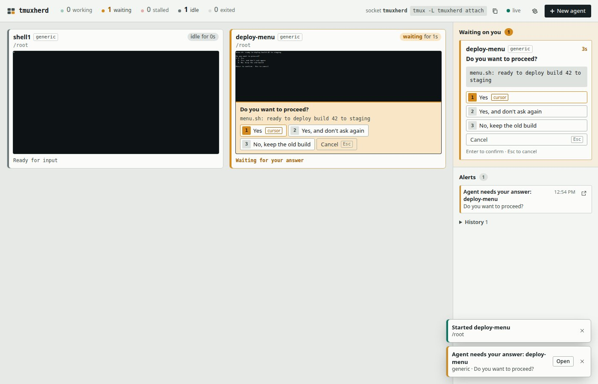
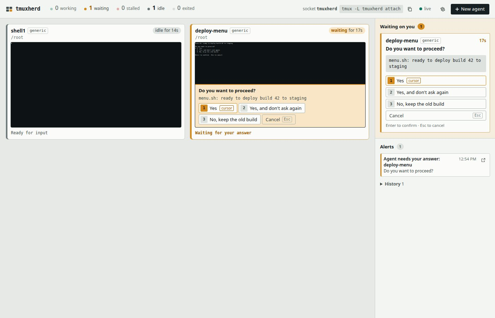
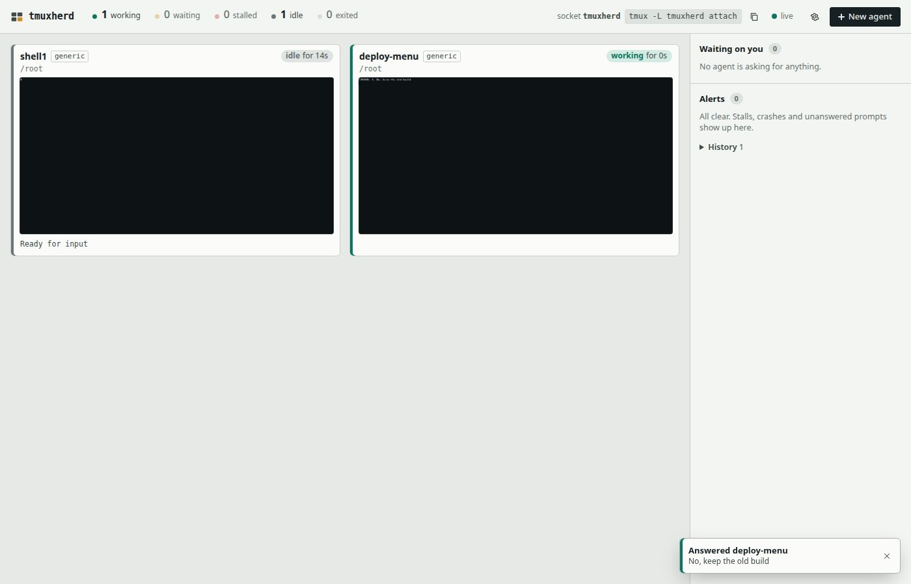
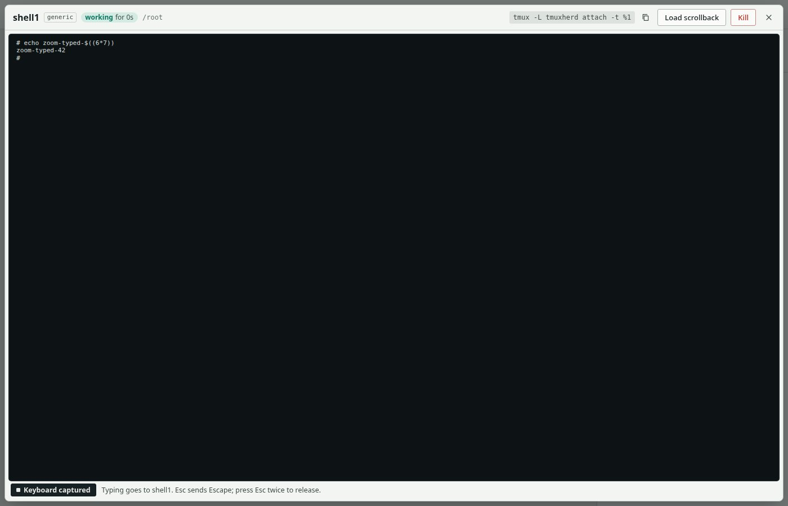
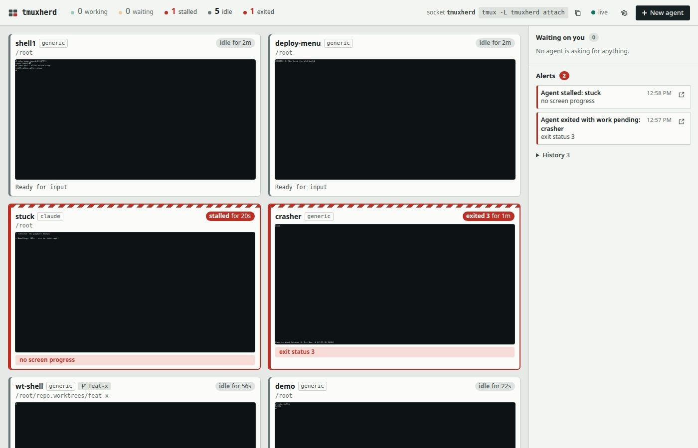

**Verdict: PASS.** Every Quickstart step, and every extra claim from the README, usage.md, api.md and SECURITY.md that I could test without real AI agents, worked as documented. The only problems were small gaps in the docs.

# Fresh-user run (run 6, on the final code)

I followed only `README.md` and the docs it links to (`docs/usage.md`, `docs/api.md`, `SECURITY.md`), read from the bare mirror with `git show HEAD:<file>`. I did not open `src/`, `public/`, `test/` or `e2e/`.

## Environment

- Date: 2026-11-06, about 07:23 to 07:31 UTC
- tmuxherd: commit `f653c8d`, installed from `git+file:///src/tmuxherd.git`, version `0.1.0`
- Image: `node:22-bookworm-slim` (`sha256:5ec23b7c…`), `--network host`, running as root
- Debian 12.15, Node v22.23.4, npm 10.9.9
- tmux 3.3a and git 2.39.5, both from `apt install`
- Container locale: `POSIX`, since `LANG` is unset in the slim image
- Browser: Playwright 1.64.1, headless Chromium 156.0.8078.4, viewport 1400×900, run on the host
- Dashboard port: 7433 (`--port 7433`). The README's default is 7420.

Redactions: tokens are cut after their first 4 characters. The machine's hostname in shell prompts and the tmux status line is replaced by `…`.

## Step 0: Install (README Quickstart, line 1 and line 2)

The README line, run as root with `sudo` dropped:

```
$ apt update && apt install -y tmux git
...
$ tmux -V; git --version
tmux 3.3a
git version 2.39.5
```

`npm install -g`, with the allowed substitution of the local mirror:

```
$ npm install -g git+file:///src/tmuxherd.git
npm error code 128
npm error An unknown git error occurred
npm error command git --no-replace-objects ls-remote file:///src/tmuxherd.git
npm error fatal: detected dubious ownership in repository at '/src/tmuxherd.git'
...
$ git config --global --add safe.directory /src/tmuxherd.git
$ npm install -g git+file:///src/tmuxherd.git
added 1 package in 840ms
$ which tmuxherd; tmuxherd --version
/usr/local/bin/tmuxherd
0.1.0
```

The ownership error comes from copying the mirror in with `docker cp`, which leaves it owned by a different uid. A real `github:` install would not hit it. After that one fix, the install took under a second and pulled in one package, which matches "zero runtime dependencies". `tmuxherd --help` printed the full flag list, and it agrees with usage.md.

## Step (a): Start the dashboard and open the printed URL

```
$ cd /root && tmuxherd --open --port 7433
tmuxherd 0.1.0 ready
  dashboard: http://127.0.0.1:7433/?token=GrN6…
  tmux:      tmux -L tmuxherd attach    (agents keep running if you stop the dashboard)
tmuxherd: could not open a browser (xdg-open); open the dashboard URL above yourself
```

The container has no browser, so `--open` failed. It degraded gracefully: it printed a clear message and the server kept running. Playwright then opened the printed URL:

- The response was `200`, and the final URL was `http://127.0.0.1:7433/`, with the token removed from the address bar as documented.
- The page title was `tmuxherd`. The page showed state counters (`0 working`, `0 waiting`, …), the attach command, a `live` status, **New agent**, an empty "Waiting on you" inbox, "Alerts", and a "No agents yet" empty state with a second **New agent** button.

The `curl` header check on the token URL:

```
HTTP/1.1 303 See Other
location: /
set-cookie: tmuxherd_7433=1e16…; HttpOnly; SameSite=Strict; Path=/
```

## Step (b): Spawn a Shell agent and a Custom-command agent

**New agent** opens a dialog with these fields:
- **Agent**: Claude Code, Codex CLI, Pi, Shell, Custom command…
- **Name**, **Directory**, **First message** and **Extra arguments**
- **Create a git worktree on a new branch**

Choosing **Custom command…** adds **Command** and **Screen format** (Generic CLI, Claude Code, Codex CLI, Pi). This matches the field table in usage.md.

1. Shell agent: Agent = Shell, Name = `shell1`, Directory = `~`, then **Start agent**.
2. Custom agent: Agent = Custom command…, Command = `/root/menu.sh`, Screen format = Generic CLI, Name = `deploy-menu`, Directory = `/root`, then **Start agent**.

`/root/menu.sh` (in this folder as `menu.sh`) is a 30-line bash menu built to the "What counts as a prompt" rules:
- a question line ending in `?`;
- three numbered options, with `❯` on the selected line;
- an `Enter to confirm · Esc to cancel` footer.

It moves the cursor with Up and Down, and on Enter it writes the chosen option to `/root/menu-result.txt`, then `exec bash`.

Both tiles appeared within about 2 s. The dashboard log:

```
[7:24:48 AM] spawned shell1 (/bin/sh) in /root
[7:24:50 AM] spawned deploy-menu (/bin/sh) in /root
[7:24:50 AM] ALERT waiting: deploy-menu — Do you want to proceed?
```

The header changed to `1 waiting`, `1 idle`. `deploy-menu` was detected as **waiting** at once, and the menu glyph `❯` rendered correctly even with the container's `POSIX` locale. `shell1` ran `/bin/sh`, because `docker exec` does not export `$SHELL`. usage.md documents that fallback ("your `$SHELL`, else `/bin/sh`").



## Step (c): Answer the prompt from the "Waiting on you" inbox with a non-default option

The inbox card showed:
- the agent name and `generic`;
- the question **Do you want to proceed?**;
- the context line `menu.sh: ready to deploy build 42 to staging`;
- buttons `1 Yes` (marked `cursor`), `2 Yes, and don't ask again`, `3 No, keep the old build` and `Cancel Esc`;
- the footer.



I clicked **3 No, keep the old build** in the inbox region. The `/api/panes/o2/answer` response the page received:

```
200 {"ok":true,"sent":["Down","Down","Enter"],"chosen":"No, keep the old build","stillShowing":false}
```

To prove the program got it, I read the file the program wrote:

```
$ cat /root/menu-result.txt
3. No, keep the old build
```

The tile then showed `CHOSEN: 3. No, keep the old build`. The inbox went back to "No agent is asking for anything.", the waiting alert cleared and moved to History, and the toast read "Answered deploy-menu · No, keep the old build". The dashboard logged `answered deploy-menu: No, keep the old build`.



## Step (d): Zoom into the shell tile, type a command, and release with Esc twice

Clicking the `shell1` tile opened a dialog named `shell1`. Its header showed `tmux -L tmuxherd attach -t %1`, **Copy attach command**, **Load scrollback**, **Kill** and **Close**. The terminal div had focus, and the footer read "Keyboard captured · Typing goes to shell1. Esc sends Escape; press Esc twice to release."

I typed `echo zoom-typed-$((6*7))` and pressed Enter. The page sent two key requests: `{"text":"echo zoom-typed-$((6*7))"}` and `{"keys":["Enter"]}`. The screen showed:

```
# echo zoom-typed-$((6*7))
zoom-typed-42
#
```

`tmux -L tmuxherd capture-pane -p -t herd:shell1` inside the container showed the same lines.



Esc, Esc (80 ms apart):
- no Escape key requests were sent;
- focus moved to the **Close** button;
- the footer changed to "Keyboard released · Click the screen to type into the agent. Esc closes this view."

Typing `zzz` afterwards sent 0 requests, and a third Esc closed the view. I also checked the other half of the rule on the `demo` shell: one Esc on its own **is** sent (`{"keys":["Escape"]}`) and the keyboard stays captured. That is what usage.md describes.

## Step (e): `tmuxherd ls`, `ls --json` and `attach`

```
$ tmuxherd ls
o1     shell1             generic idle         1m  /root
o2     deploy-menu        generic idle         1m  /root
$ tmuxherd ls --json
[
  {
    "key": "o1", "paneId": "%1", "pid": 3715, "own": true, "socket": "tmuxherd",
    "name": "shell1", "session": "herd", "harness": "generic", "state": "idle",
    "since": 1793949954528, "reason": null, "pending": false,
    "lastProgress": 1793949954528, "stuckSince": null, "prompt": null,
    "activity": null, "error": null, "cwd": "/root", "worktree": null,
    "dead": false, "exitStatus": null, "width": 200, "height": 50,
    "created": 1793949888135, "command": "/bin/sh",
    "attach": "tmux -L tmuxherd attach -t %1"
  },
  { "key": "o2", ... "name": "deploy-menu", ... "command": "/bin/sh -c /root/menu.sh", ... }
]
```

I reflowed the JSON for space; the field set is exactly the pane view object in api.md. Both commands exited with status 0.

`attach`, run under a pseudo-terminal with `TERM=xterm-256color`. The second command ran while attached, and Ctrl-b d was sent after 2.5 s:

```
$ TERM=xterm-256color script -qfec "tmuxherd attach" /root/attach.log
root@…:~#
...
[tmuxherd]0:home* 1:shell1  2:deploy-menu              "…" 07:25 06-Nov-26
[detached (from session herd)]
$ tmux -L tmuxherd list-clients -F "client #{client_tty} session=#{session_name} window=#{window_name} term=#{client_termname}"
client /dev/pts/3 session=herd window=home term=xterm-256color
```

It attached to session `herd`, landed on the `home` window, showed both agents as windows in tmuxherd's own status line, and detached with Ctrl-b d, as usage.md says. `tmuxherd attach nosuch` printed `can't find session: nosuch`.

## Step (f): Stop the dashboard; the agents keep running

I sent SIGINT (Ctrl-C) to the `tmuxherd` node process:

```
node alive? no
tmux server alive? yes
$ curl http://127.0.0.1:7433/            (from the host)
curl: (7) Failed to connect to 127.0.0.1 port 7433 after 0 ms: Couldn't connect to server
$ tmuxherd ls
o1     shell1             generic idle         1m  /root
o2     deploy-menu        generic idle         1m  /root
$ tmux -L tmuxherd list-windows -F "#{window_index}:#{window_name} pid=#{pane_pid} dead=#{pane_dead}"
0:home pid=3710 dead=0
1:shell1 pid=3715 dead=0
2:deploy-menu pid=3728 dead=0
$ tmux -L tmuxherd send-keys -t herd:shell1 "echo still-alive-after-stop" Enter
# echo still-alive-after-stop
still-alive-after-stop
```

I restarted it with a fixed token for the API checks: `TMUXHERD_TOKEN=$(node -e …randomBytes(24)…) tmuxherd --port 7433`. It printed `dashboard: http://127.0.0.1:7433/?token=1e16…`. The new dashboard showed both agents again, with the same names, `generic` harness and screens, including the `still-alive-after-stop` line typed while it was down. That confirms "Start the dashboard again and it picks them all up".

## Step (g): Other documented promises

### Settings panel (usage.md, "Thresholds can also be changed at runtime")

The gear button **Watchdog and notification settings** opens a "Settings" dialog with:
- **Stalled after** (5), **Exited alert after** (0) and **Waiting alert after** (0), in minutes;
- **Alert when an agent asks a question** (checked);
- a notification status line, **Browser notifications …** and **Send test alert**.

Setting **Stalled after** to `0.5` and then `1` posted `/api/config`. The response was `200 {"ok":true,"thresholds":{"stallMinutes":1,…}}`, and the panel said "Saved. The watchdog uses these values from now on."

**Send test alert** returned `{"ok":true,"results":{}}` because no desktop notifier or webhook was configured. It showed the toast "tmuxherd test alert: tmuxherd · test · notifications are working".

Browser notifications stayed on "Browser notifications blocked" (disabled). In headless Chromium, `Notification.permission` is `denied` even after `grantPermissions(['notifications'])`, so this test environment can't exercise "Enable notifications". I left it **untested**.

### Stall alert

I added a Custom agent `stuck` running `/root/spin.sh` with Screen format = Claude Code. The script draws `> refactor the payment module`, then redraws `✻ Pondering… (Ns · esc to interrupt)` every second, cycling the glyph, word and timer but changing nothing else.
- It was detected as `claude` / **working**.
- About 1 minute later (threshold 1 min), it turned **stalled** with reason `no screen progress` (`activity: "✻ Musing… (65s · esc to interrupt)"`). The log showed `ALERT stalled: stuck — no screen progress`, and the Alerts panel showed "Agent stalled: stuck". So the tracker ignored the ticking timer and spinner, as documented.

### Exited with work pending

A Custom agent `crasher` running `echo working on it; sleep 4; echo boom >&2; exit 3` became **exited 3**. It raised "Agent exited with work pending: crasher · exit status 3" at once (`--dead-minutes 0` is the default).



### Worktree spawn

Agent = Shell, Name = `wt-shell`, Directory = `/root/repo` (a fresh git repo), with **Create a git worktree on a new branch** checked and Branch = `feat-x` (From left empty). The Branch field had pre-filled from Name.

```
201 {"ok":true,"key":"o5",...,"cwd":"/root/repo.worktrees/feat-x","worktree":{"path":"/root/repo.worktrees/feat-x","branch":"feat-x","repo":"/root/repo"},"argv":["/bin/sh"]}
$ git -C /root/repo worktree list
/root/repo                   0cde06d [main]
/root/repo.worktrees/feat-x  0cde06d [feat-x]
```

The tile showed a `feat-x` branch badge and the path `/root/repo.worktrees/feat-x`.

### Load scrollback and Kill (zoom view)

- **Load scrollback** sent `GET /api/panes/o6/screen?history=500`.
- The first **Kill** click sent nothing and changed the buttons to "Back to live" and "Kill demo?". The second click sent `DELETE /api/panes/o6`, closed the view and removed the tile. The log showed `killed demo`, and window `demo` was gone from `tmux -L tmuxherd list-windows`.

### The HTTP API with a Bearer token (api.md example, port 7433)

```
$ H=(-H "Authorization: Bearer $TMUXHERD_TOKEN" -H 'content-type: application/json')
$ curl -s "${H[@]}" -X POST localhost:7433/api/spawn -d '{"preset":"shell","name":"demo","cwd":"~"}'
{"ok":true,"key":"o6","paneId":"%6","name":"demo","cwd":"/root","harness":"generic","worktree":null,"argv":["/bin/sh"]}
$ curl -s "${H[@]}" -X POST localhost:7433/api/panes/o6/keys -d '{"text":"echo hello","keys":["Enter"]}'
{"ok":true}
$ curl -s "${H[@]}" localhost:7433/api/panes/o6/screen | head -c 300
{"key":"o6","screen":"# echo hello\nhello\n#\n\n\n...
```

I also spawned `menu2` (`{"preset":"custom","command":"/root/menu.sh","harness":"generic",…}`). It was reported as `waiting`, `kind: "permission"`, with all three options and fingerprint `f855ece5`.

| Request | Result |
|---|---|
| answer with `{"fingerprint":"deadbeef","option":1}` | `409 {"ok":false,"error":"the prompt changed since you saw it; refresh and try again"}` |
| answer with the current fingerprint and `"action":"cancel"` | `200 {"ok":true,"sent":["Escape"]}` |
| answer with the current fingerprint and `"option":1` | `200 {"ok":true,"sent":["Down","Enter"],"chosen":"Yes, and don't ask again",…}`. `menu-result.txt` then read `2. Yes, and don't ask again`, so `option` is the 0-based `index`. |

### Auth, Host and Origin checks (api.md and SECURITY.md)

| Request | Result |
|---|---|
| `GET /api/state`, no auth | `401 {"ok":false,"error":"unauthorized"}` |
| `GET /api/state`, wrong Bearer | `401 unauthorized` |
| `GET /api/state`, Bearer, `Host: evil.example` | `421 {"ok":false,"error":"bad host header"}` |
| `GET /api/state`, Bearer, `Host: localhost:7433` | `200` |
| `GET /api/state`, cookie, `Host: rebind.evil.example` | `421 bad host header` |
| `POST /api/config`, cookie, no `Origin` | `403 {"ok":false,"error":"missing origin"}` |
| `POST /api/config`, cookie, `Origin: https://evil.example` | `403 cross-origin request refused` |
| `DELETE /api/panes/o4`, cookie, `Origin: https://evil.example` | `403 cross-origin request refused` |
| `POST /api/config`, cookie, `Origin: http://127.0.0.1:7433` | `200` |
| `POST /api/config`, Bearer, no `Origin` | `200` |
| `POST /api/config`, Bearer, `content-type: text/plain` | `415 expected application/json` |
| `POST /api/config`, Bearer, 70 KB JSON | `413 body too large` |
| `GET /api/panes/o99/screen` | `404 unknown pane o99` |
| `GET /api/panes/%251/screen` (raw tmux target) | `404 not found` |

The headers on `GET /` were:

```
content-security-policy: default-src 'self'; script-src 'self'; style-src 'self'; img-src 'self' data:; connect-src 'self'; font-src 'self'; object-src 'none'; base-uri 'none'; frame-ancestors 'none'; form-action 'self'
x-frame-options: DENY
x-content-type-options: nosniff
referrer-policy: no-referrer
```

### CLI safety, troubleshooting and config file

```
$ tmuxherd --port 7433          # while one is running
tmuxherd: cannot listen on 127.0.0.1:7433: listen EADDRINUSE: address already in use 127.0.0.1:7433 (another tmuxherd? use --port 0 for a random port)
exit=1
$ tmuxherd --host 0.0.0.0 --port 7499
tmuxherd: refusing to bind 0.0.0.0: pass --allow-remote if you really mean it (see SECURITY.md)
exit=2
```

The config file test used `/root/cfg.json`:

```json
{ "stallMinutes": 8, "presets": { "aider": { "label": "Aider", "argv": ["aider"], "promptArg": false, "harness": "generic" } } }
```

I started a second instance with `tmuxherd --config /root/cfg.json --stall-minutes 3 --port 7498`. Its `GET /api/state` returned `thresholds.stallMinutes: 3`, so the CLI flag overrode the file. The presets were `claude, codex, pi, shell, aider` ("Aider"). That instance was then stopped with SIGINT.

### Final stop

After a second SIGINT to the main dashboard, the host got `curl … -> 000`. `tmuxherd ls` still listed all six remaining agents (crasher, stuck, deploy-menu, shell1, menu2, wt-shell). I then stopped the container with `docker stop th-fresh6`.

Extra screenshots, kept for reference: `x-initial.jpg`, `x-dialog.jpg`, `x-settings.jpg`, `x-test-alert.jpg`, `x-g-spawned.jpg`, `x-zoom-released.jpg`. The tile thumbnails in the screenshots show the container's bash prompt at an unreadable size.

## Friction points

| # | Kind | What happened |
|---|---|---|
| 1 | Environment | `npm install -g git+file://…` failed with git "dubious ownership" until I ran `git config --global --add safe.directory`. It comes from the `docker cp`'d mirror's ownership, not from tmuxherd; a `github:` install would not hit it. |
| 2 | Environment | `tmuxherd --open` could not open a browser in the headless container. It printed a clear fallback message and kept serving. |
| 3 | Docs gap | api.md's answer body `{fingerprint, option}` doesn't say whether `option` is the 0-based `index` or the displayed `number`. It is the index: `option: 1` picked the item labelled "2". |
| 4 | Docs gap | `tmuxherd ls` (a fresh, one-shot poll) showed the stalled `stuck` agent as `working`. Stall needs history, so `ls` cannot report it. usage.md hints at this only for `--json`'s `since`/`lastProgress`. |
| 5 | Cosmetic | After the restart, `tmuxherd ls` rows were not in key order (`o4 o3 o2 o1 o7 o5`), and the exited `crasher` row had an empty cwd column. |
| 6 | Docs gap (minor) | **Send test alert** with no desktop notifier or webhook returns `results: {}` and shows only a toast, not an entry in the Alerts list. The docs don't say where the test alert appears. |
| 7 | Untested | Browser notifications ("Enable notifications"): headless Chromium reports `Notification.permission = denied` even after granting it, so the button stayed "Browser notifications blocked". |
| 8 | Note | The Shell preset ran `/bin/sh` (prompt `#`), because `$SHELL` is not exported under `docker exec`. This matches the documented fallback. |

## Follow-up (added by the maintainer)

- 3: api.md now says `option` is the 0-based `index`.
- 4: usage.md now says `ls` is a one-shot snapshot that cannot show **stalled**.
- 5: added to the 0.1.1 list in `docs/ROADMAP.md` (row order was already there).
- 6: usage.md now says where a test alert shows up.
- 1, 2, 7, 8: test environment, not tmuxherd behavior. Browser notifications are covered by `e2e/fake.spec.js` with a stubbed Notification API.
- In `fresh-user-answered.jpg` and `fresh-user-stalled.jpg`, the `deploy-menu` thumbnail's second line (the container's bash prompt, which includes the host name under `--network host`) was painted over.
